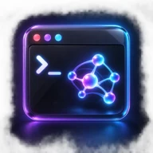

 

  

### Practical software. Local intelligence. Thoughtful interfaces.

Building tools that stay close to the user—and are ready to run for real.

 

## Profile

<table>
<tr>
<td width="62%" valign="top">
<h3>Build local. Ship real.</h3>

I create local-first AI products, terminal agents, Linux desktop applications, and focused developer tools. My work combines useful automation with clear permission boundaries and calm, intentional interfaces.

</td>
<td width="38%" valign="top">
<h3>Current signal</h3>

<strong>Environment</strong> — Linux &amp; GNOME 
<strong>Direction</strong> — Local AI &amp; agents 
<strong>Interface</strong> — Terminal &amp; desktop 
<strong>Languages</strong> — Arabic &amp; English

</td>
</tr>
</table>

## Selected projects

<table>
<tr>
<td width="72" align="center"></td>
<td valign="middle"><h3><a href="https://github.com/fouadcyper/tangarine">Tangarine</a></h3>Native radial file conversion for Kali Linux, GNOME, and Wayland.  <code>Python</code> <code>GJS</code> <code>GTK4</code> <code>libadwaita</code></td>
<td width="84" align="right"><a href="https://github.com/fouadcyper/tangarine"><strong>View ↗</strong></a></td>
</tr>
<tr>
<td width="72" align="center"></td>
<td valign="middle"><h3><a href="https://github.com/fouadcyper/fouad-cybershield">Fouad CyberShield</a></h3>Arabic-first cybersecurity services for protection, response, and awareness.  <code>TypeScript</code> <code>React</code> <code>Cloudflare</code></td>
<td width="84" align="right"><a href="https://github.com/fouadcyper/fouad-cybershield"><strong>View ↗</strong></a></td>
</tr>
<tr>
<td width="72" align="center"></td>
<td valign="middle"><h3><a href="https://github.com/fouadcyper/fouad-ai-cli">Fouad AI CLI</a></h3>Privacy-first bilingual AI coding workspace for local models and providers.  <code>TypeScript</code> <code>React</code> <code>Local AI</code></td>
<td width="84" align="right"><a href="https://github.com/fouadcyper/fouad-ai-cli"><strong>View ↗</strong></a></td>
</tr>
<tr>
<td width="72" align="center"></td>
<td valign="middle"><h3><a href="https://github.com/fouadcyper/fouad-coder-agent">Fouad Coder Agent</a></h3>Keyboard-first terminal coding agent with project tools and persistent sessions.  <code>Python</code> <code>Textual</code> <code>Ollama</code></td>
<td width="84" align="right"><a href="https://github.com/fouadcyper/fouad-coder-agent"><strong>View ↗</strong></a></td>
</tr>
<tr>
<td width="72" align="center"></td>
<td valign="middle"><h3><a href="https://github.com/fouadcyper/zoey-kali-agent">Zoey Kali Agent</a></h3>Arabic voice-focused desktop AI companion built for Kali Linux.  <code>TypeScript</code> <code>Electron</code> <code>Whisper</code> <code>Piper</code></td>
<td width="84" align="right"><a href="https://github.com/fouadcyper/zoey-kali-agent"><strong>View ↗</strong></a></td>
</tr>
<tr>
<td width="72" align="center"></td>
<td valign="middle"><h3><a href="https://github.com/fouadcyper/fouad-ai-trading-agent">AI Trading Agent</a></h3>Local market-intelligence desktop app using public data and local models.  <code>Python</code> <code>PySide6</code> <code>Binance data</code></td>
<td width="84" align="right"><a href="https://github.com/fouadcyper/fouad-ai-trading-agent"><strong>View ↗</strong></a></td>
</tr>
<tr>
<td width="72" align="center"></td>
<td valign="middle"><h3><a href="https://github.com/fouadcyper/fouad-cli">Fouad CLI</a></h3>Cross-platform command-line media utility for video, image, and audio.  <code>Node.js</code> <code>JavaScript</code> <code>CLI</code></td>
<td width="84" align="right"><a href="https://github.com/fouadcyper/fouad-cli"><strong>View ↗</strong></a></td>
</tr>
</table>

<a href="https://github.com/fouadcyper?tab=repositories"><strong>Explore all repositories →</strong></a>

## Toolkit

<table>
<tr>
<td width="34%" valign="top"><strong>Languages</strong>    </td>
<td width="33%" valign="top"><strong>Interfaces</strong>    </td>
<td width="33%" valign="top"><strong>Systems</strong>    </td>
</tr>
</table>

## Principles

<table>
<tr>
<td width="50%" valign="top"><strong>01 — Local-first</strong> Privacy, speed, and user control stay close to the machine.</td>
<td width="50%" valign="top"><strong>02 — Explicit boundaries</strong> Permissions, credentials, and destructive actions stay visible.</td>
</tr>
<tr>
<td width="50%" valign="top"><strong>03 — Real deliverables</strong> Working software, clear installation, and honest validation.</td>
<td width="50%" valign="top"><strong>04 — Calm interfaces</strong> Focused experiences that feel native to their platform.</td>
</tr>
</table>

 

<strong>Open to thoughtful collaboration on local AI, Linux, and developer tooling.</strong>

  

