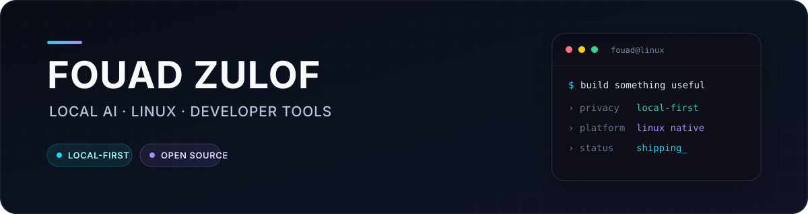
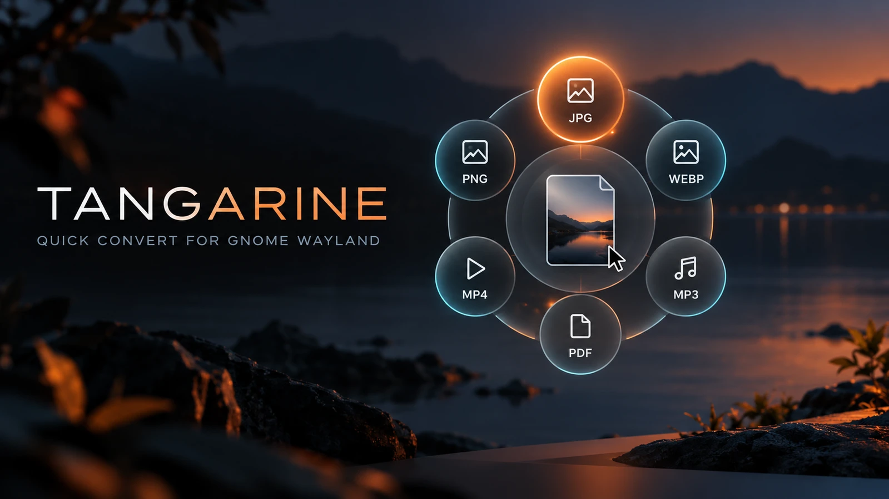

 

  

**I build focused software that keeps capable tools close to the user.**

Local AI products · Terminal agents · Linux desktop apps · Developer tooling

## What I build

I turn practical ideas into tools people can actually run. My work sits at the
intersection of **local AI**, **Linux**, and **developer experience**—with clear
permission boundaries, thoughtful interfaces, and a strong preference for
software that works on the user's own machine.

## Featured work

<h3><a href="https://github.com/fouadcyper/tangarine">Tangarine</a></h3>

Native radial file conversion for Kali Linux, GNOME, and Wayland.

<code>Python</code> <code>GJS</code> <code>GTK4</code> <code>libadwaita</code>

<table>
<tr>
<td width="50%" valign="top">
<h3><a href="https://github.com/fouadcyper/fouad-cybershield">Fouad CyberShield</a></h3>

An Arabic cybersecurity services website for authorized testing, web protection, incident response, and security awareness.

<code>TypeScript</code> <code>React</code> <code>Cloudflare</code>

</td>
<td width="50%" valign="top">
<h3><a href="https://github.com/fouadcyper/fouad-ai-cli">Fouad AI CLI</a></h3>

A privacy-first bilingual AI coding workspace for local models, providers, plugins, skills, and secure account linking.

<code>TypeScript</code> <code>React</code> <code>Local AI</code>

</td>
</tr>
<tr>
<td width="50%" valign="top">
<h3><a href="https://github.com/fouadcyper/fouad-coder-agent">Fouad Coder Agent</a></h3>

A keyboard-first terminal coding agent with project tools, persistent sessions, and provider health monitoring.

<code>Python</code> <code>Textual</code> <code>Ollama</code>

</td>
<td width="50%" valign="top">
<h3><a href="https://github.com/fouadcyper/zoey-kali-agent">Zoey Kali Agent</a></h3>

An Arabic voice-focused desktop AI companion for Kali Linux with local capture, transcription, and assistant workflows.

<code>TypeScript</code> <code>Electron</code> <code>Whisper</code> <code>Piper</code>

</td>
</tr>
<tr>
<td width="50%" valign="top">
<h3><a href="https://github.com/fouadcyper/fouad-ai-trading-agent">AI Trading Agent</a></h3>

A local-AI cryptocurrency market intelligence desktop app powered by public market data and local model servers.

<code>Python</code> <code>PySide6</code> <code>Binance data</code>

</td>
<td width="50%" valign="top">
<h3><a href="https://github.com/fouadcyper/fouad-cli">Fouad CLI</a></h3>

A cross-platform command-line media utility for downloading supported video, image, and audio content.

<code>Node.js</code> <code>JavaScript</code> <code>CLI</code>

</td>
</tr>
</table>

## Toolkit

  
  
  
  
  
  
  
  

## How I work

- **Local-first by default** when privacy, speed, and user control matter.
- **Explicit permissions** around commands, credentials, and destructive actions.
- **Real deliverables** with installation paths, documentation, and honest testing boundaries.
- **Calm interfaces** that feel focused, intentional, and native to their platform.

 

<a href="https://github.com/fouadcyper?tab=repositories"><strong>Explore all projects →</strong></a>

  

Open to thoughtful collaboration on local AI, Linux, and developer tooling.

